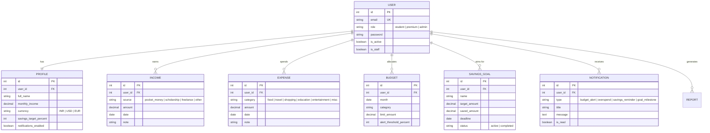

# 💰 BudgetBuddy — Full-Stack Personal Finance & Budget Management

<div align="center">


[](https://www.djangoproject.com/)
[](https://www.django-rest-framework.org/)
[](https://react.dev/)
[](https://vitejs.dev/)
[](https://www.sqlite.org/)
[](https://www.postgresql.org/)
[](https://jwt.io/)

**An intelligent, modern, full-stack personal finance application built to help individuals, students, and professionals track daily transactions, monitor category budgets, manage savings targets, and generate in-depth financial analytics and exportable reports.**

[Features](#-key-features) • [Tech Stack](#-tech-stack) • [Database Architecture](#-database-architecture) • [Quick Start](#-quick-start-guide) • [Demo Credentials](#-demo-credentials--seed-data) • [API Reference](#-api-endpoints)

</div>

---

## 📌 Table of Contents
- [✨ Key Features](#-key-features)
- [🛠️ Tech Stack](#-tech-stack)
- [🗄️ Database Architecture](#-database-architecture)
- [📁 Project Structure](#-project-structure)
- [🚀 Quick Start Guide](#-quick-start-guide)
  - [⚡ Option 1: One-Click Launch (Windows)](#option-1-one-click-launch-windows)
  - [🔧 Option 2: Step-by-Step Manual Setup](#option-2-step-by-step-manual-setup)
- [🔐 Demo Credentials & Seed Data](#-demo-credentials--seed-data)
- [📡 API Endpoints](#-api-endpoints)
- [⚙️ Environment Variables](#️-environment-variables)
- [📜 License](#-license)

---

## ✨ Key Features

| Feature | Description |
|---|---|
| **📊 Smart Dashboard** | Real-time overview of Total Balance, Monthly Incomes, Expenses, Savings Rate, and Recent Transactions. |
| **💳 Transaction Management** | Add, edit, filter, search, and delete categorized income sources and expense items with custom notes and dates. |
| **🎯 Category Budgets & Alerts** | Set monthly spending limits per category (Food, Travel, Education, Shopping, Entertainment, etc.) with real-time threshold warnings (e.g. 80%). |
| **🏆 Savings Goals** | Define target amounts and deadlines, track visual progress bars, and make quick deposits toward your financial goals. |
| **📈 Visual Analytics** | Visual breakdowns of income streams, spending distributions, category-by-category charts, and net savings trends. |
| **📑 Comprehensive Reports** | Generate monthly financial summaries and export data seamlessly to **CSV**, **Excel (.xlsx)**, and printable **PDF / HTML**. |
| **🔔 In-App Notifications** | Automatic alert system notifying users of budget threshold breaches, overspending, savings reminders, and goal milestones. |
| **🔒 Secure Authentication** | JSON Web Token (JWT) authentication with refresh tokens, password hashing, and Role-Based Access Control (**Student**, **Premium**, **Admin**). |
| **🎨 Modern Glassmorphic UI** | Premium responsive interface crafted with CSS glassmorphism, fluid animations, dark theme, and mobile-friendly layouts. |

---

## 🛠️ Tech Stack

### Frontend
- **Library/Framework**: [React 18](https://react.dev/) (Single Page Application)
- **Bundler & Dev Server**: [Vite 5](https://vitejs.dev/) with Fast Refresh
- **Styling**: Vanilla CSS3 Design System with CSS custom properties, glassmorphism, responsive CSS Grid / Flexbox
- **Icons & UI Elements**: SVG iconography, interactive modal dialogs, status badges, progress bars
- **HTTP Client**: Native Fetch API with JWT Bearer Token interceptors and automatic token refresh handling

### Backend
- **Framework**: [Django 5.x](https://www.djangoproject.com/) & [Django REST Framework (DRF)](https://www.django-rest-framework.org/)
- **Authentication**: `djangorestframework-simplejwt` (Short-lived access tokens + rotating refresh tokens)
- **CORS Handling**: `django-cors-headers` (Configured for local Vite dev server and production clients)
- **Data Exporting**: Python `csv`, Excel (`openpyxl` / report generator), and styled HTML/PDF report views
- **Data Seeding**: Built-in Django management command (`python manage.py seed_data`) to populate mock data

### Database & Storage
- **Development**: **SQLite 3** (`db.sqlite3`) — Out-of-the-box zero-configuration embedded database.
- **Production**: **PostgreSQL** (`psycopg2-binary`) — Robust relational database support enabled via `.env` variables.

---

## 🗄️ Database Architecture

BudgetBuddy utilizes an enterprise-grade relational database schema managed through Django's ORM:



### Switching between Databases:
- **SQLite (Default)**: If `DB_NAME` is left empty in `budgetbuddy_backend/.env`, Django automatically uses `db.sqlite3`.
- **PostgreSQL**: Set `DB_NAME`, `DB_USER`, `DB_PASSWORD`, `DB_HOST`, and `DB_PORT` in `budgetbuddy_backend/.env` to connect directly to PostgreSQL.

---

## 📁 Project Structure

```text
budgetbuddy/
├── budgetbuddy_backend/         # Django REST Framework API
│   ├── config/                  # Django project root settings, URLs, WSGI/ASGI
│   ├── finance/                 # Incomes, Expenses, Budgets, Goals, Analytics
│   │   └── management/commands/ # seed_data.py command
│   ├── notifications/           # In-app notifications & alert models/views
│   ├── reports/                 # Financial reports, CSV/Excel/PDF export views
│   ├── users/                   # Custom User model, Profile, JWT auth views
│   ├── manage.py                # Django CLI utility
│   ├── requirements.txt         # Python backend dependencies
│   └── .env.example             # Backend environment template
├── frontend/                    # React 18 + Vite Web Application
│   ├── src/
│   │   ├── components/          # Dashboard, Transactions, Budgets, Goals, Analytics, Reports, Settings
│   │   ├── App.jsx              # Main app shell & routing
│   │   ├── api.js               # Centralized API service with JWT authentication
│   │   ├── main.jsx             # React DOM entry point
│   │   └── styles.css           # Glassmorphism design system & responsive styling
│   ├── index.html               # Frontend HTML root template
│   ├── package.json             # NPM dependencies & scripts
│   ├── vite.config.js           # Vite dev server configuration
│   └── .env.example             # Frontend environment template
├── start_dev.bat                # 1-Click launcher for Windows Command Prompt
├── start_dev.ps1                # 1-Click launcher for Windows PowerShell
├── .gitignore                   # Monorepo git exclusion rules
└── README.md                    # Project documentation
```

---

## 🚀 Quick Start Guide

### Prerequisites
Make sure you have the following installed on your machine:
- **Python** (version 3.10 or newer)
- **Node.js** (version 18 or newer) & **npm**
- **Git**

---

### Option 1: One-Click Launch (Windows)

If you are on Windows, you can start both the Django backend and Vite frontend simultaneously:

**Using PowerShell:**
```powershell
.\start_dev.ps1
```

**Using Command Prompt:**
```cmd
start_dev.bat
```

This launches the Django API at `http://127.0.0.1:8000/` and opens the React web interface at `http://127.0.0.1:5173/`.

---

### Option 2: Step-by-Step Manual Setup

#### Step 1: Set Up Backend (Django)

1. Open a terminal and navigate to the backend directory:
   ```bash
   cd budgetbuddy_backend
   ```

2. Create and activate a Python virtual environment:
   ```bash
   # Windows
   python -m venv venv
   venv\Scripts\activate

   # macOS / Linux
   python3 -m venv venv
   source venv/bin/activate
   ```

3. Install dependencies:
   ```bash
   pip install -r requirements.txt
   ```

4. Set up environment variables:
   ```bash
   cp .env.example .env
   ```

5. Run database migrations:
   ```bash
   python manage.py migrate
   ```

6. *(Recommended)* Populate the database with realistic demo data:
   ```bash
   python manage.py seed_data
   ```

7. Start the backend development server:
   ```bash
   python manage.py runserver 127.0.0.1:8000
   ```
   Backend will be running at: `http://127.0.0.1:8000/`

---

#### Step 2: Set Up Frontend (React + Vite)

1. Open a new terminal and navigate to the frontend directory:
   ```bash
   cd frontend
   ```

2. Install dependencies:
   ```bash
   npm install
   ```

3. (Optional) Set up frontend environment variables:
   ```bash
   cp .env.example .env
   ```

4. Start the Vite development server:
   ```bash
   npm run dev
   ```
   Frontend will be running at: `http://127.0.0.1:5173/`

---

## 🔐 Demo Credentials & Seed Data

When you run `python manage.py seed_data`, the following pre-configured test accounts are created with rich transaction and budget records:

| Role | Email | Password | Description |
|---|---|---|---|
| **🎓 Student** | `student@budgetbuddy.local` | `Student123!` | Student budget, pocket money & freelance income, active savings goals |
| **⭐ Premium** | `premium@budgetbuddy.local` | `Premium123!` | Higher income, multi-category budgets, investment targets |
| **🛡️ Admin** | `admin@budgetbuddy.local` | `Admin123!` | Superuser with full access to Django Admin (`/admin/`) |

---

## 📡 API Endpoints

All API endpoints are prefixed with `/api/`. Protected endpoints require a Bearer JWT Token in the request header (`Authorization: Bearer <access_token>`).

### 🔑 Authentication (`/api/auth/`)
| Endpoint | Method | Auth | Description |
|---|---|---|---|
| `/api/auth/register/` | `POST` | Public | Register a new user account |
| `/api/auth/login/` | `POST` | Public | Authenticate user and receive JWT access + refresh tokens |
| `/api/auth/refresh/` | `POST` | Public | Obtain a new access token using refresh token |
| `/api/auth/me/` | `GET` / `PATCH` | Bearer | Get or update current user profile & preferences |

### 💵 Finance Management (`/api/finance/`)
| Endpoint | Method | Auth | Description |
|---|---|---|---|
| `/api/finance/incomes/` | `GET`, `POST` | Bearer | List or create income records |
| `/api/finance/incomes/<id>/` | `GET`, `PUT`, `DELETE` | Bearer | Retrieve, update, or remove an income entry |
| `/api/finance/expenses/` | `GET`, `POST` | Bearer | List or create expense records |
| `/api/finance/expenses/<id>/` | `GET`, `PUT`, `DELETE` | Bearer | Retrieve, update, or remove an expense entry |
| `/api/finance/budgets/` | `GET`, `POST` | Bearer | List or configure monthly category budgets |
| `/api/finance/goals/` | `GET`, `POST` | Bearer | List or create savings goals |
| `/api/finance/goals/<id>/deposit/` | `POST` | Bearer | Deposit funds into an active savings goal |
| `/api/finance/analytics/` | `GET` | Bearer | Get aggregated financial metrics & category breakdown |

### 🔔 Notifications (`/api/notifications/`)
| Endpoint | Method | Auth | Description |
|---|---|---|---|
| `/api/notifications/` | `GET` | Bearer | Retrieve user notifications & unread alerts |
| `/api/notifications/<id>/read/` | `POST` | Bearer | Mark a notification as read |
| `/api/notifications/read-all/` | `POST` | Bearer | Mark all notifications as read |

### 📊 Reports & Exports (`/api/reports/`)
| Endpoint | Method | Auth | Description |
|---|---|---|---|
| `/api/reports/summary/?month=YYYY-MM` | `GET` | Bearer | Monthly financial summary breakdown |
| `/api/reports/export-csv/?month=YYYY-MM` | `GET` | Bearer | Export monthly financial report as CSV |
| `/api/reports/export-excel/?month=YYYY-MM` | `GET` | Bearer | Export monthly financial report as Excel |
| `/api/reports/export-pdf/?month=YYYY-MM` | `GET` | Bearer | Export monthly financial report as PDF/HTML |

---

## ⚙️ Environment Variables

### Backend (`budgetbuddy_backend/.env`)
```ini
# Security & Debugging
SECRET_KEY=your-strong-secret-key-here
DEBUG=True
ALLOWED_HOSTS=localhost,127.0.0.1

# CORS Allowed Origins (Comma separated)
CORS_ALLOWED_ORIGINS=http://localhost:3000,http://localhost:5173,http://127.0.0.1:3000,http://127.0.0.1:5173

# Database (Leave DB_NAME empty to use default SQLite)
DB_NAME=
DB_USER=
DB_PASSWORD=
DB_HOST=localhost
DB_PORT=5432
```

### Frontend (`frontend/.env`)
```ini
# Backend API Base URL
VITE_API_URL=http://127.0.0.1:8000
```

---

## 🧪 Testing

Run backend automated tests using Django's test runner:
```bash
cd budgetbuddy_backend
python manage.py test
```

---

## 🤝 Contributing

Contributions, issues, and feature requests are welcome!
1. Fork the Project
2. Create your Feature Branch (`git checkout -b feature/AmazingFeature`)
3. Commit your Changes (`git commit -m 'Add some AmazingFeature'`)
4. Push to the Branch (`git push origin feature/AmazingFeature`)
5. Open a Pull Request

---

## 📜 License

Distributed under the **MIT License**. See `LICENSE` for more information.

<div align="center">
  <sub>Built with ❤️ by <a href="https://github.com/harisaravananm">Hari Saravanan M</a></sub>
</div>
